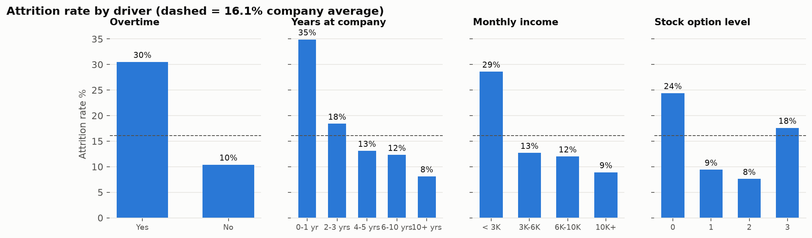
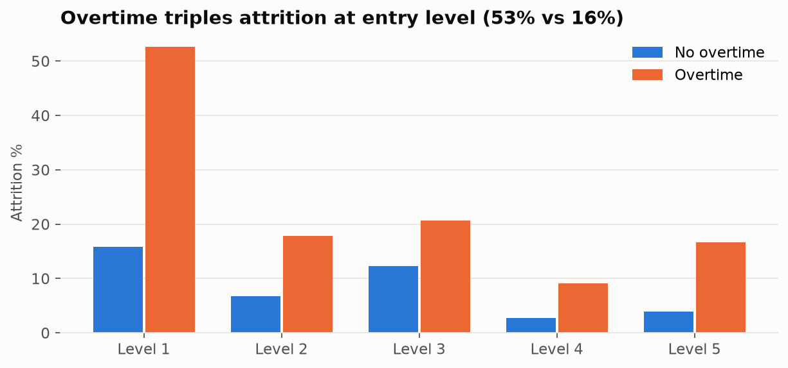
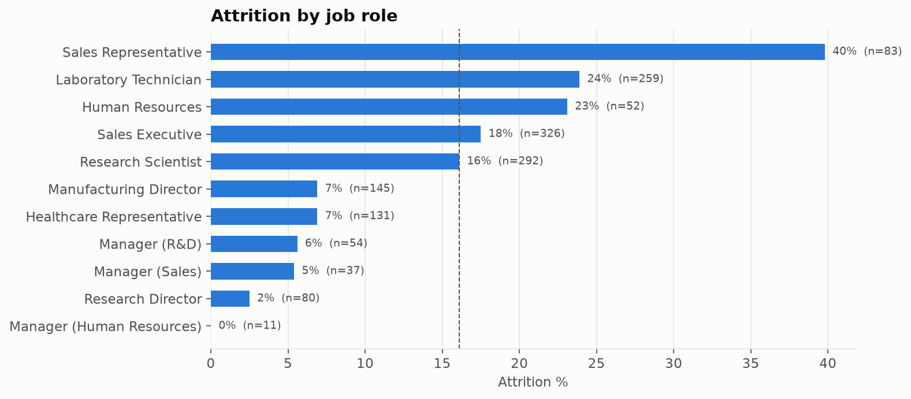
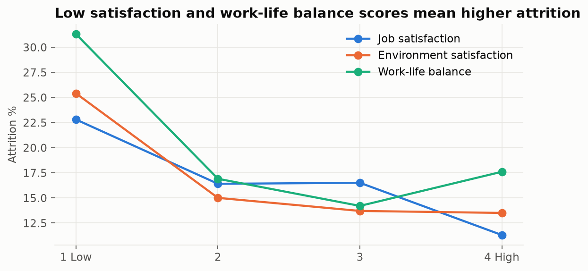

# 👥 HR Attrition Analytics: Why Employees Leave, What It Costs & Who Is at Risk

**▶ Live interactive dashboard:** https://pragati-gautam14.github.io/hr-attrition-analytics/

People analytics on **1,470 employees** (IBM HR dataset). The project finds what drives the **16.1% attrition rate**, estimates its cost (**≈ $6.8M**), builds **explainable flight-risk segments** HR can act on, sizes the impact of an overtime policy, and runs a **gender pay-equity check**.

**Stack:** SQL (DuckDB) · Python (pandas, SciPy, scikit-learn, statsmodels) · Matplotlib / Plotly · Jupyter · Power BI (DAX)

---

## 📌 Key findings

| # | Finding | Recommendation |
|---|---|---|
| 1 | Attrition **16.1%** (237 leavers), est. **$6.8M** replacement cost; **34.9%** attrition in the first year | Strengthen onboarding and first-year check-ins |
| 2 | **Overtime:** 31% attrition vs 10% without; at job level 1 it is **53% vs 16%** | Cap and monitor junior overtime. Worth **≈83 avoided exits (35% of leavers, ≈$2.3M)** |
| 3 | **Two flight-risk profiles = 15% of staff but 45% of leavers:** under 40 + under 3 years' tenure + no stock (52%), and entry-level + overtime (46%) | Targeted retention package for these segments |
| 4 | Sales Representatives (**40%**) and Lab Technicians (**24%**, the most leavers: 62) are paid below $3K a month | Pay and career-path review for these roles |
| 5 | No stock options → 24% attrition vs 8–9% with level 1–2 grants; work-life balance score 1 → 31% | Broaden equity grants; act on low survey scores |
| 6 | **Pay equity:** raw median gap −5% (women earn more). **Adjusted gap 0.01%, p = 0.99** | No adjusted gap. Repeat the check each review cycle |






## 🔬 Method

1. **SQL data model** (`sql/01_clean.sql`): drops 3 constant columns, builds age, tenure and income bands, and an engagement index. Includes a data-quality log (no nulls or duplicates).
2. **SQL KPI layer** (`sql/02_attrition_kpis.sql`): long-format attrition-by-dimension table, overtime × level matrix, role scorecard with `RANK()`, leaver vs stayer profile with `UNPIVOT`, and cost estimates with `FILTER` aggregates.
3. **Statistics** (`src/attrition_analysis.py`): chi-square + Cramér's V and Mann-Whitney U + rank-biserial for 26 candidate drivers.
4. **Segmentation:** a depth-3 decision tree turns the drivers into plain-English rules (AUC 0.69), benchmarked against logistic regression (AUC 0.80).
5. **What-if:** exits avoided if overtime employees left at the non-overtime rate of their own job level.
6. **Pay equity:** OLS on log(income) with gender, job level, experience, department and education.

## 📂 Structure
```
├── data/raw/hr_employee_attrition.csv
├── sql/                       # cleaning + KPI models
├── src/run_pipeline.py        # SQL → tables, Power BI file
├── src/attrition_analysis.py  # tests, segments, what-if, pay equity
├── src/build_report.py        # charts + docs/index.html
├── notebooks/analysis.ipynb   # narrated walkthrough
├── outputs/tables/ · outputs/charts/
├── powerbi/                   # clean table + DAX measures
└── docs/index.html            # interactive dashboard (GitHub Pages)
```

## ▶️ Run

> ⚙️ **Automated:** the full pipeline (SQL models → analysis → charts → notebook → dashboard) re-runs on **GitHub Actions** (`.github/workflows/build.yml`) whenever `sql/` or `src/` changes.

```bash
pip install -r requirements.txt
python src/download_data.py
python src/run_pipeline.py && python src/attrition_analysis.py && python src/build_report.py
```

**Dataset:** IBM HR Analytics Employee Attrition & Performance (IBM sample data, via [IBM/employee-attrition-aif360](https://github.com/IBM/employee-attrition-aif360)). Fictional data created by IBM data scientists.
